# Pavel Erokhin

Software engineer and architect in Madrid, focused on AI agents and the tooling around them: agent harnesses, MCP servers, and LLM evaluation.

In engineering since 2017. I’ve worked on high-load mobile and backend systems at Wildberries (100M+ MAU), Guava Pay, Alfa-Bank, and MTS Bank, designing and shipping features from architecture to release.

### AI agents

<a href="https://allay.chat"><picture><source media="(prefers-color-scheme: dark)" srcset="cards/allay-en-dark.svg">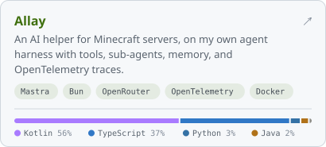</picture></a>
<a href="https://github.com/MairwunNx/ctxray"><picture><source media="(prefers-color-scheme: dark)" srcset="cards/ctxray-en-dark.svg">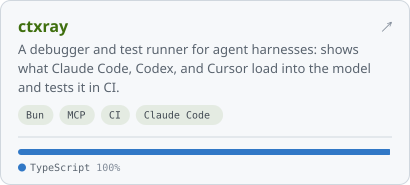</picture></a>

<a href="https://github.com/MairwunNx/minecraft-mcp"><picture><source media="(prefers-color-scheme: dark)" srcset="cards/mcp-en-dark.svg">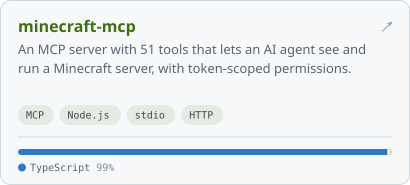</picture></a>
<a href="https://github.com/MairwunNx/xi"><picture><source media="(prefers-color-scheme: dark)" srcset="cards/xi-en-dark.svg">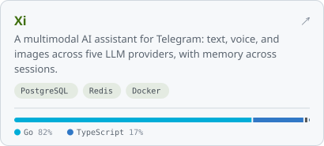</picture></a>

### Architecture

<a href="https://github.com/MairwunNx/Capsa"><picture><source media="(prefers-color-scheme: dark)" srcset="cards/capsa-en-dark.svg">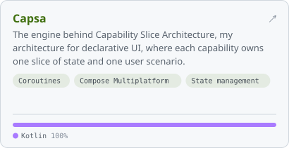</picture></a>
<a href="https://github.com/MairwunNx/Feature-Action-Architecture"><picture><source media="(prefers-color-scheme: dark)" srcset="cards/faa-en-dark.svg">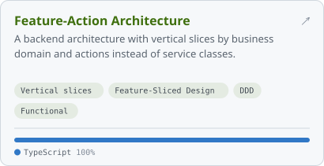</picture></a>

### Systems programming and reverse engineering

Built on JVM and Android Runtime (ART) internals: garbage collection, JIT compilation, and profiling with Java Flight Recorder.

<a href="https://ancaria.dev"><picture><source media="(prefers-color-scheme: dark)" srcset="cards/ancaria-en-dark.svg">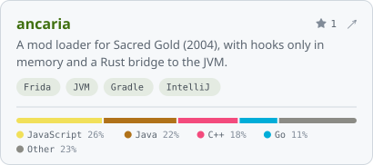</picture></a>
<a href="https://github.com/bytekodex"><picture><source media="(prefers-color-scheme: dark)" srcset="cards/bytekodex-en-dark.svg">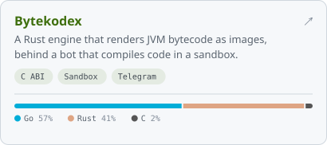</picture></a>

### Backend and observability

<a href="https://github.com/MairwunNx/minecraft-worldapi"><picture><source media="(prefers-color-scheme: dark)" srcset="cards/worldapi-en-dark.svg">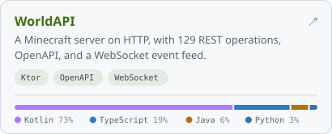</picture></a>
<a href="https://github.com/MairwunNx/minecraft-exporter"><picture><source media="(prefers-color-scheme: dark)" srcset="cards/exporter-en-dark.svg">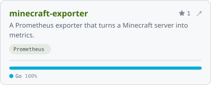</picture></a>

<a href="https://github.com/MairwunNx/minecraft-grafana"><picture><source media="(prefers-color-scheme: dark)" srcset="cards/grafana-en-dark.svg">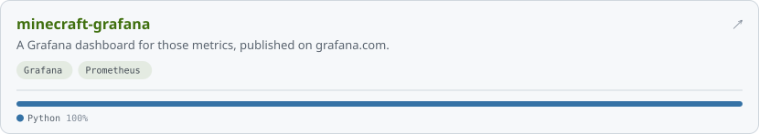</picture></a>

Some projects here are finished, some are in active development, and others are no longer maintained.

  
  
  
  
  
  
  
  
  
  
  
  
  
  

  <b>Fueled by</b>
  

---

Русская версия

# Павел Ерохин

Инженер-программист и архитектор из Мадрида. Специализируюсь на ИИ-агентах и инструментах вокруг них: ИИ-харнессах, MCP-серверах и оценке качества LLM.

В разработке с 2017 года. Работал над высоконагруженными мобильными и серверными системами в Wildberries (100M+ MAU), Guava Pay, Альфа-Банке и МТС Банке: проектировал и выпускал фичи от архитектуры до релиза.

### ИИ-агенты

<a href="https://allay.chat"><picture><source media="(prefers-color-scheme: dark)" srcset="cards/allay-ru-dark.svg">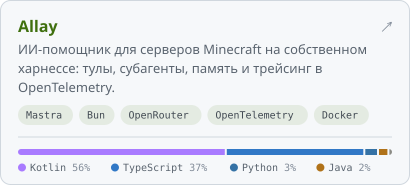</picture></a>
<a href="https://github.com/MairwunNx/ctxray"><picture><source media="(prefers-color-scheme: dark)" srcset="cards/ctxray-ru-dark.svg">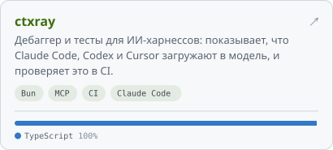</picture></a>

<a href="https://github.com/MairwunNx/minecraft-mcp"><picture><source media="(prefers-color-scheme: dark)" srcset="cards/mcp-ru-dark.svg">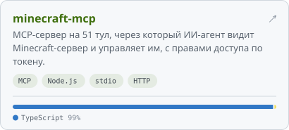</picture></a>
<a href="https://github.com/MairwunNx/xi"><picture><source media="(prefers-color-scheme: dark)" srcset="cards/xi-ru-dark.svg">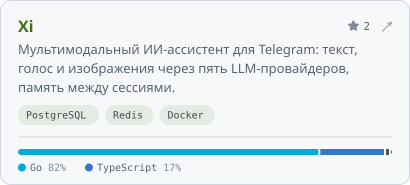</picture></a>

### Архитектура

<a href="https://github.com/MairwunNx/Capsa"><picture><source media="(prefers-color-scheme: dark)" srcset="cards/capsa-ru-dark.svg">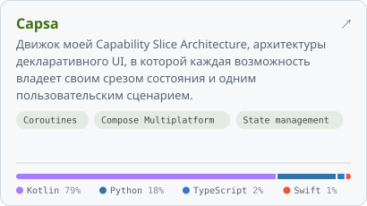</picture></a>
<a href="https://github.com/MairwunNx/Feature-Action-Architecture"><picture><source media="(prefers-color-scheme: dark)" srcset="cards/faa-ru-dark.svg">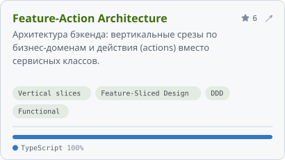</picture></a>

### Системное программирование и реверс-инжиниринг

Опираюсь на знание внутреннего устройства JVM и Android Runtime (ART): сборки мусора, JIT-компиляции, профилирования через Java Flight Recorder.

<a href="https://ancaria.dev"><picture><source media="(prefers-color-scheme: dark)" srcset="cards/ancaria-ru-dark.svg">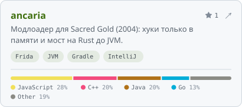</picture></a>
<a href="https://github.com/bytekodex"><picture><source media="(prefers-color-scheme: dark)" srcset="cards/bytekodex-ru-dark.svg">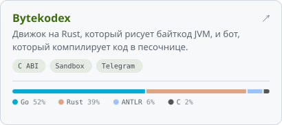</picture></a>

### Бэкенд и наблюдаемость

<a href="https://github.com/MairwunNx/minecraft-worldapi"><picture><source media="(prefers-color-scheme: dark)" srcset="cards/worldapi-ru-dark.svg">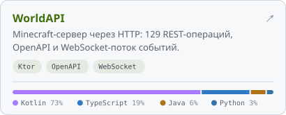</picture></a>
<a href="https://github.com/MairwunNx/minecraft-exporter"><picture><source media="(prefers-color-scheme: dark)" srcset="cards/exporter-ru-dark.svg">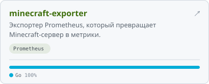</picture></a>

<a href="https://github.com/MairwunNx/minecraft-grafana"><picture><source media="(prefers-color-scheme: dark)" srcset="cards/grafana-ru-dark.svg">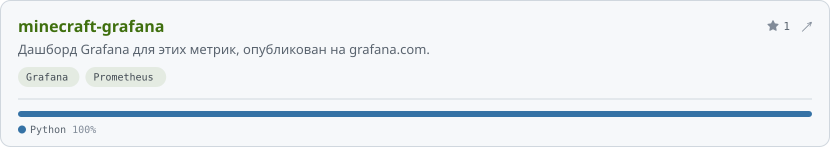</picture></a>

Часть проектов здесь завершена, часть в разработке, а некоторые я больше не поддерживаю.

Versión en español

# Pavel Erokhin

Ingeniero de software y arquitecto en Madrid, centrado en agentes de IA y las herramientas a su alrededor: agent harnesses, servidores MCP y evaluación de LLM.

En la ingeniería desde 2017. He trabajado en sistemas móviles y backend de alta carga en Wildberries (más de 100M de MAU), Guava Pay, Alfa-Bank y MTS Bank, diseñando y lanzando funciones desde la arquitectura hasta la versión final.

### Agentes de IA

<a href="https://allay.chat"><picture><source media="(prefers-color-scheme: dark)" srcset="cards/allay-es-dark.svg">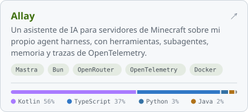</picture></a>
<a href="https://github.com/MairwunNx/ctxray"><picture><source media="(prefers-color-scheme: dark)" srcset="cards/ctxray-es-dark.svg">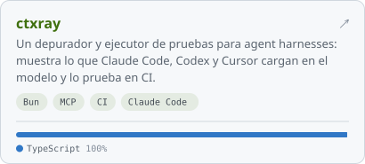</picture></a>

<a href="https://github.com/MairwunNx/minecraft-mcp"><picture><source media="(prefers-color-scheme: dark)" srcset="cards/mcp-es-dark.svg">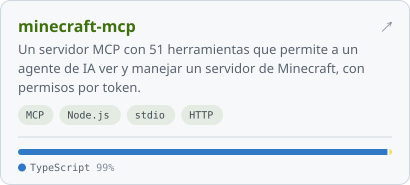</picture></a>
<a href="https://github.com/MairwunNx/xi"><picture><source media="(prefers-color-scheme: dark)" srcset="cards/xi-es-dark.svg">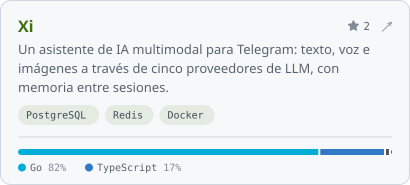</picture></a>

### Arquitectura

<a href="https://github.com/MairwunNx/Capsa"><picture><source media="(prefers-color-scheme: dark)" srcset="cards/capsa-es-dark.svg">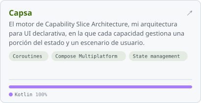</picture></a>
<a href="https://github.com/MairwunNx/Feature-Action-Architecture"><picture><source media="(prefers-color-scheme: dark)" srcset="cards/faa-es-dark.svg">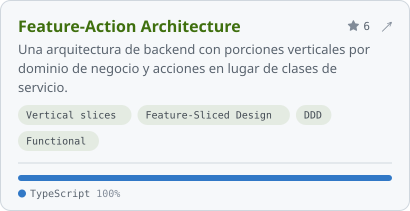</picture></a>

### Programación de sistemas e ingeniería inversa

Basada en los componentes internos de la JVM y de Android Runtime (ART): recolección de basura, compilación JIT y perfilado con Java Flight Recorder.

<a href="https://ancaria.dev"><picture><source media="(prefers-color-scheme: dark)" srcset="cards/ancaria-es-dark.svg">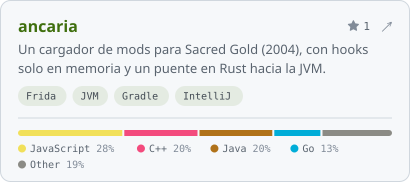</picture></a>
<a href="https://github.com/bytekodex"><picture><source media="(prefers-color-scheme: dark)" srcset="cards/bytekodex-es-dark.svg">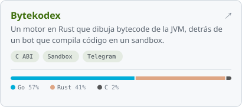</picture></a>

### Backend y observabilidad

<a href="https://github.com/MairwunNx/minecraft-worldapi"><picture><source media="(prefers-color-scheme: dark)" srcset="cards/worldapi-es-dark.svg">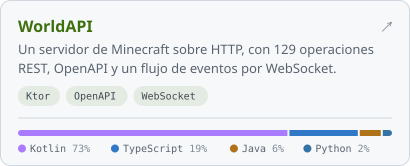</picture></a>
<a href="https://github.com/MairwunNx/minecraft-exporter"><picture><source media="(prefers-color-scheme: dark)" srcset="cards/exporter-es-dark.svg">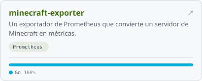</picture></a>

<a href="https://github.com/MairwunNx/minecraft-grafana"><picture><source media="(prefers-color-scheme: dark)" srcset="cards/grafana-es-dark.svg">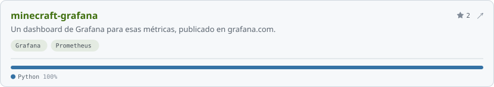</picture></a>

Algunos proyectos están terminados, otros siguen en desarrollo y algunos ya no reciben mantenimiento.

---

[t.me/mairwunnx](https://t.me/mairwunnx) · [mairwunnx.com](https://mairwunnx.com)
